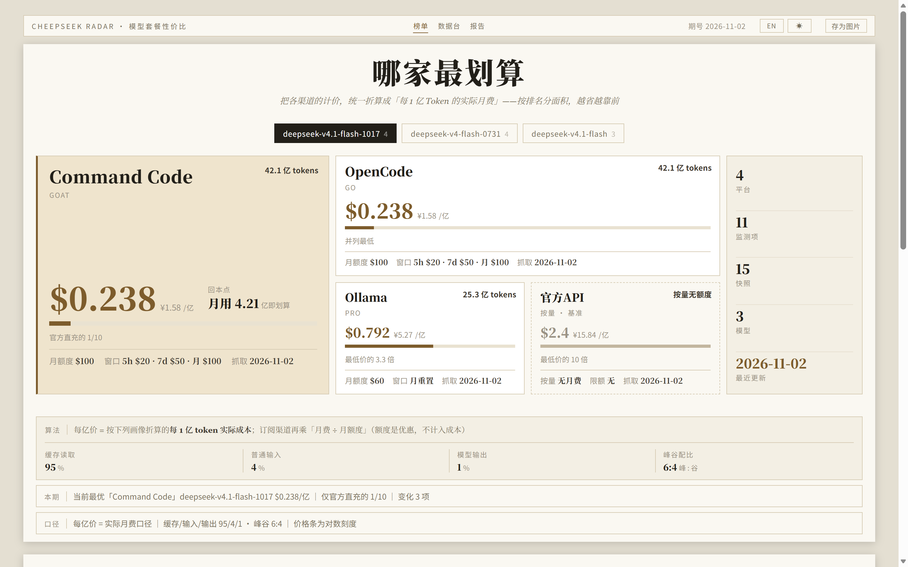
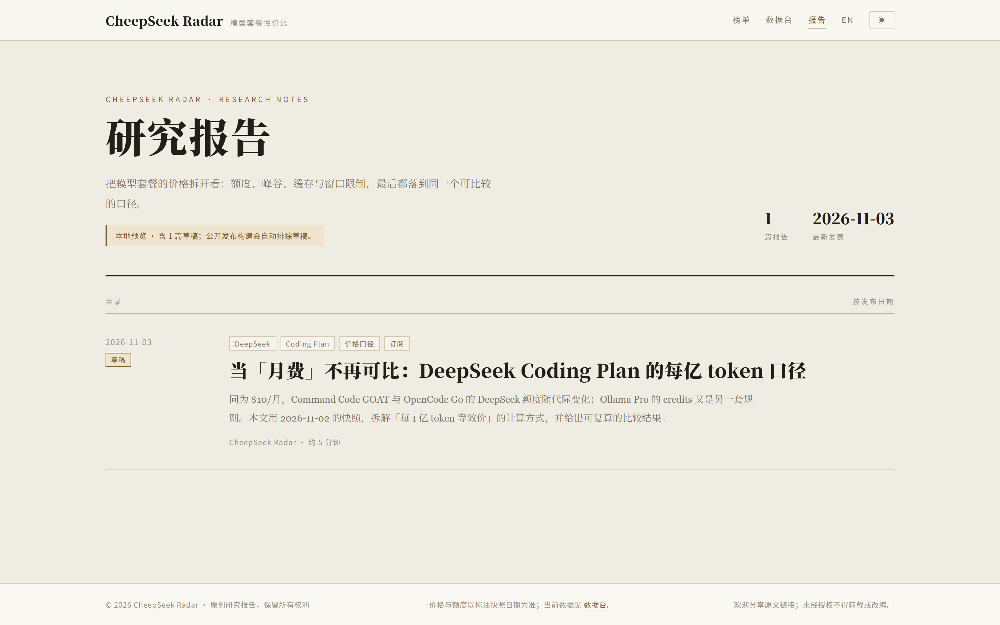

# CheepSeek Radar

> 🌐 [简体中文](README.md)

**A value-for-money radar for model subscription plans** — normalizing model subscription plans across platforms into a comparable "price per 100M tokens".

CheepSeek Radar is a local-first price tracking tool focused on **DeepSeek** and the Coding Plans around it (official API, Command Code GOAT, OpenCode Go, Ollama Pro). It answers two questions:

> At the same usage level, which plan is the best deal?
> Below what usage level does pay-as-you-go actually become cheaper?



<sub>Hero leaderboard: ranked by value for money, with the official pay-as-you-go channel shown as a dimmed "baseline" cell; parameters and currency can be adjusted in real time.</sub>

---

## Why it exists

Platforms price their plans in incompatible ways: some charge a monthly fee, some sell quota, some split peak/off-peak rates, some discount on cache hits — and usage windows come in 5-hour / weekly / monthly flavors. Comparing "monthly fees" or "unit prices" directly leads to wrong conclusions.

CheepSeek Radar normalizes every "platform × model × plan" quote into an **equivalent price per 100M tokens**, and keeps a snapshot of every inspection. Price changes, quota adjustments and expiring promotions show up on the panel as up/down marks; history is append-only, never overwritten.

## Core capabilities

| Capability | Description |
|---|---|
| **One comparable basis** | Monthly fees, quota, peak/off-peak prices and cache prices are all normalized to a "price per 100M tokens", covering both pay-as-you-go and subscription pricing |
| **Snapshot tracking** | Every inspection produces a snapshot, auto-compared against the previous round with up/down coloring; history is never overwritten and can be reviewed at any point in time |
| **Three views** | Hero leaderboard (ranked by value), data sheet (full CRUD with filtering and sorting), and interactive 3:4 image cards / poster (in-card parameter tuning, live preview, PNG export) |
| **Adjustable assumptions** | Cache-read / plain-input / output shares, peak/off-peak mix, display currency and FX rate are all adjustable; three built-in usage profiles, results recompute in real time |
| **Channel differences made visible** | Quotas of different model lines on the same platform are shown independently (e.g. OpenCode's legacy $30 / $60 vs the 1017 line's $100), avoiding one-size-fits-all miscalculation |
| **Local-first** | Data lives in a local SQLite database — no uploads, no cloud storage; the panel and the CLI both work offline for history |
| **Research reports** | Built-in index page and long-form reader; written in Markdown, previewed locally; public builds exclude drafts and the reports ship with the public static site |
| **Bilingual UI** | Full Simplified Chinese / English interface, one-click switch in the brand bar, preference persisted in the browser; the report system builds matching Chinese and English editions (an `en/` directory with cross-links) |
| **Three-state theme** | Light / Dark / Follow system; the dark theme carries over the warm-paper + copper-gold editorial look; exported image cards and posters always use the light design and are unaffected by the theme |
| **Public static site** | `python build_public.py` exports local data into a read-only static site under `site/`, ready to host on GitHub Pages; the maintenance environment and the public site are kept separate (see below) |
| **Zero dependencies** | Python standard library + vanilla HTML/CSS/JS; no third-party packages to install and no build step for the app itself |

## Quick start

### Requirements

- Python 3.9+ (standard library only)
- A modern browser (Chrome / Edge / Firefox / Safari)

### Windows: double-click launch

Double-click `monitor\打开监控台.vbs` (a Chinese-named launcher, "Open Monitor Console"): it starts the local server silently and opens the browser automatically.

- The server stays alive while the panel page is open (a heartbeat every 30 seconds);
- 5 minutes after the page is closed, the server exits automatically;
- You can also click "Stop server" at the bottom-right of the panel to exit immediately.

`monitor\启动监控台.bat` ("Start Monitor Console") is the diagnostic mode (keeps the console window with logs) — use it only when startup misbehaves.

### Command line

```bash
cd monitor
python server.py --port 8765 --open --idle-exit 5
# Open http://127.0.0.1:8765/
```

### CLI only

```bash
cd monitor
python monitor.py latest          # Latest state per platform × model × plan
python monitor.py diff            # Compare the last two snapshots, report changes
python monitor.py history --platform opencode
python monitor.py dump -o snapshots.csv
```

## Public static site

The local **maintenance environment** (SQLite + admin panel + draft preview) and the **public browsing environment** (read-only data + profile-based computation + image-card export + report reading) are separate. One command exports the current data into a purely static site:

```bash
python build_public.py        # Generates site/ (reports built for the public, drafts excluded)
```

Output layout (point the GitHub Pages root at `site/` to host it):

```text
site/
├─ index.html        # Read-only panel (data comes from data/*.json, admin features hidden)
├─ data/*.json       # Snapshots and metadata exported from plans.db (same shape as the local /api)
├─ reports/          # Static report build (including the en/ English edition)
└─ poster.html       # Standalone poster page
```

- **Maintenance environment (local)**: the `monitor\plans.db` SQLite snapshot store + full CRUD in the panel + CLI inspections + draft preview;
- **Public environment (hosted)**: read-only data (JSON) + real-time recomputation under adjustable profiles + image-card export + report reading; no database, no admin features, no drafts.

The panel and the CLI themselves remain zero-dependency and build-free; `build_public.py` is an optional export script (standard library only as well) and plays no part in running the panel.

## Pricing basis

Core formula (the panel computes this in real time; all views share it):

```text
Price per 100M tokens = Σ(share of each token type × peak/off-peak weighted unit price) × 100
(unit prices are per 1M tokens; ×100 converts to the per-100M-token price)

Cache-read share  = cachePct (of all tokens)
Plain-input share = inputPct (of all tokens)
Output share      = outputPct (of all tokens)
The three shares sum to 100%
Weighted unit price = peakPct × peak price + (1 - peakPct) × off-peak price

Effective per-100M price (subscription) = pay-as-you-go per-100M price × (monthly fee ÷ monthly quota)
Per-100M price (pay-as-you-go)          = the list-price basis
```

Built-in usage profiles (switch to "Custom" to keep tuning):

| Preset | Cache reads | Plain input | Output | Peak:off-peak |
|---|---:|---:|---:|---|
| 95/4/1 | 95% | 4% | 1% | 6:4 |
| 97/2.5/0.5 | 97% | 2.5% | 0.5% | 6:4 |
| 98/1.6/0.4 | 98% | 1.6% | 0.4% | 6:4 |

> These are calculation scenarios, not universally validated real-world averages. All three shares use total tokens as the denominator — this is not a "cache hit rate of input tokens". The default currency / FX rate is USD / 6.65.

> Basis note: the "effective monthly-fee basis" treats the monthly fee as a cost and the monthly quota as a discount — it measures "how much money you actually paid for how many tokens", which suits purchase decisions and is not a replica of the platform's bill.

**Total quota** (100M tokens / month) = monthly quota ÷ pay-as-you-go per-100M price.  
**Break-even point** (100M tokens / month) = monthly fee ÷ pay-as-you-go per-100M price; below that usage, pay-as-you-go is cheaper.

## Current coverage

Data as of the **2026-11-02** snapshot: **4 platforms / 3 model lines / 15 snapshots / 11 tracked items**.

| Platform | Plan | Current main model | Fee / monthly quota | Fetching |
|---|---|---|---|---|
| DeepSeek Official API | Pay-as-you-go | `deepseek-v4.1-flash-1017` | none / — | Manual |
| Command Code | GOAT | `deepseek-v4.1-flash-1017` | $10 / $100 (model-level) | Automatic |
| OpenCode | Go | `deepseek-v4.1-flash-1017` | $10 / $100 (model-level) | Automatic |
| Ollama | Pro | `deepseek-v4.1-flash-1017` | $20 / $60 (shared account credits) | Automatic |

Model lines: `deepseek-v4.1-flash-1017` (current), `deepseek-v4.1-flash` (historical), `deepseek-v4-flash-0731` (historical).

> Prices and quotas can change at any time; the values above are point-in-time snapshots. Live results follow the panel and `monitor\plans.db`. Data sources and verification rules per platform are documented in [docs/DATA-SOURCES.md](docs/DATA-SOURCES.md) (Chinese).

## Research reports

The "Reports" entry in the top navigation opens `http://127.0.0.1:8765/reports/`. Reports are written in Markdown and built into purely static HTML; the local preview and the public site share the same pages.



- Index page: a directory-style research journal, ordered by publication date.
- Article page: multi-level headings, lists, quotes, links, images, tables and code blocks, with an auto-generated in-page table of contents.
- Bilingual: a report can ship as a Chinese/English pair (`X.md` and `X.en.md`) with a cross-link in the page header; the English build lands in the `en/` directory.
- Drafts: front matter `status: draft`, visible in local preview only; public builds exclude them automatically.
- For the writing and publishing workflow see [reports/README.md](reports/README.md) (Chinese).

```bash
python reports/build.py --preview   # Local preview build (includes drafts)
python reports/build.py             # Public build (published only)
```

## Project structure

```text
cheepSeek radar/
├─ monitor/                 # The product itself
│  ├─ plans.db              # SQLite snapshot store (snapshots + templates)
│  ├─ monitor.py            # CLI: add / latest / diff / history / dump / fetch
│  ├─ server.py             # Local HTTP server (single instance + heartbeat + idle exit)
│  ├─ panel.html            # Single-file web panel (leaderboard + data sheet + image cards)
│  ├─ poster.html           # Standalone 3:4 poster
│  ├─ favicon.svg / .ico / apple-touch-icon.png
│  ├─ 打开监控台.vbs         # Windows one-click launcher (recommended)
│  └─ 启动监控台.bat         # Diagnostic-mode launcher
├─ docs/                    # Product documentation
├─ reports/                 # Research reports: Markdown sources + static generator + output
│  ├─ posts/                # Report Markdown
│  ├─ assets/               # Report styles and images
│  ├─ build.py              # Static generator
│  └─ dist/                 # Build output (rebuilt on each build)
├─ build_public.py          # Public static site builder (exports site/)
├─ site/                    # Public site output (generated by build_public.py, hostable on GitHub Pages)
├─ archive/                 # Historical archive (old versions, historical artifacts, rollback points)
├─ README.md
├─ README.en.md             # This file (English mirror)
├─ HANDOFF.md               # Development handoff: current state / decisions / to-dos
├─ CONTRIBUTING.md
└─ CHANGELOG.md
```

## Documentation

The documents below are currently written in Chinese.

| Document | Contents |
|---|---|
| [docs/PRODUCT.md](docs/PRODUCT.md) | Product positioning, target users, value proposition, principles and non-goals |
| [docs/ARCHITECTURE.md](docs/ARCHITECTURE.md) | Architecture, data model, pricing algorithm, API and extension points |
| [docs/DATA-SOURCES.md](docs/DATA-SOURCES.md) | Data sources, fetching rules, update workflow and data-quality requirements |
| [monitor/README.md](monitor/README.md) | Monitor console manual (CLI, panel, data conventions, known pitfalls) |
| [reports/README.md](reports/README.md) | Writing reports, draft/publish workflow and local preview |
| [CONTRIBUTING.md](CONTRIBUTING.md) | Data and code contribution guide |
| [HANDOFF.md](HANDOFF.md) | Development handoff and current to-dos |
| [CHANGELOG.md](CHANGELOG.md) | Version changelog |

## Development

```bash
# Start the server (development mode)
cd monitor
python server.py --port 8765 --open

# Rehearse on a scratch database without touching production data
MONITOR_DB=/tmp/test.db python monitor.py add --date 2026-11-02 --platform Ollama ...

# Reports: local preview build (includes drafts)
python reports/build.py --preview

# Public site export: generates site/ (read-only panel + data JSON + reports, hostable on GitHub Pages)
python build_public.py
```

- The front end is a single-file `panel.html` with no build step; refresh the browser after editing.
- The back end depends only on the Python standard library; new capabilities should stay zero-dependency.
- Back up `monitor\plans.db` before writing data.
- Please verify startup and the panel's core flows before submitting; see [CONTRIBUTING.md](CONTRIBUTING.md).

## Status

Current version **v0.1.0** (2026-11-03, productization starting point). Core tracking, the leaderboard, the panel, image cards and automatic fetching are all usable.

## Data & disclaimer

- All prices and quotas come from each platform's public pricing page or official documentation, with the source URL and fetch date recorded; platform redesigns, promotions and regional differences can all make data stale.
- This tool outputs **estimates based on public quotes and usage profiles**, not replicas of platform bills; actual charges are determined by each platform's settlement.
- This project does not provide any model access, proxy or resale service.
- Spotted a data error or a price change? Contributions are welcome via [CONTRIBUTING.md](CONTRIBUTING.md).

## Copyright & Authorization Status

- **Source code** is source-available and has **no open-source license yet**; do not copy, redistribute or create derivative works without the owner's prior permission, beyond what applicable law allows. See [COPYRIGHT.md](COPYRIGHT.md).
- **Original research reports and charts** are All Rights Reserved; sharing the original link is welcome, but wholesale reproduction, substantial copying or translation/adaptation requires authorization.
- Third-party pricing data and trademarks belong to their respective owners.
