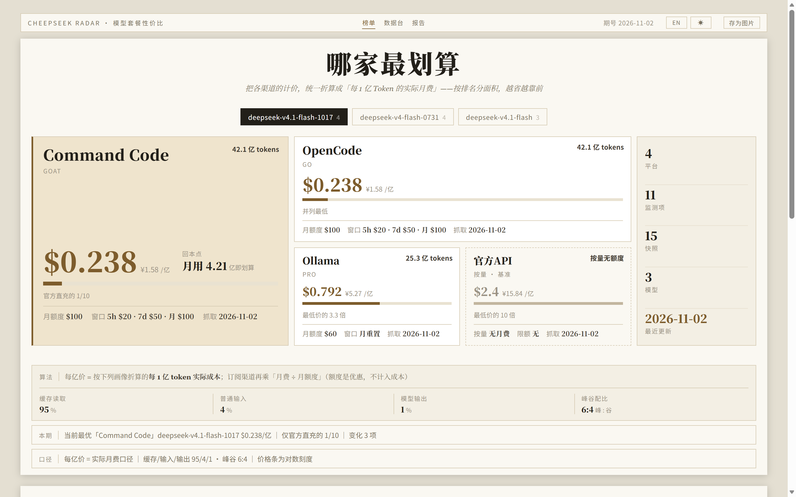
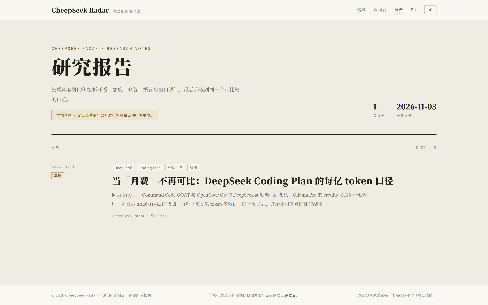

# CheepSeek Radar

> 🌐 [English](README.en.md)

**模型套餐性价比雷达** —— 把不同平台的模型订阅套餐，折算成可比较的「每 1 亿 token 价格」。

CheepSeek Radar 是一个本地优先的价格追踪工具，聚焦 **DeepSeek** 及其周边 Coding Plan（官方 API、Command Code GOAT、OpenCode Go、Ollama Pro）。它回答两个问题：

> 同样的用量，买哪家套餐最划算？
> 用量低于多少时，按量付费反而更便宜？



<sub>头页榜单：按性价比排名，官方直充作为「基准格」虚化呈现；参数与币种可实时调整。</sub>

---

## 为什么需要它

各平台的计价方式彼此不通：有的收月费、有的卖额度，有的分峰谷、有的按缓存命中打折，窗口限制还有 5 小时 / 周 / 月之分。直接比「月费」或「单价」都会得出错误结论。

CheepSeek Radar 把「平台 × 模型 × 套餐」的报价统一折算为 **每 1 亿 token 等效价**，并保留每次抓取的快照。价格变动、额度调整、促销结束都会在面板上以涨跌标记呈现，历史数据只追加、不覆盖。

## 核心能力

| 能力 | 说明 |
|---|---|
| **统一口径** | 月费、额度、峰谷价、缓存价统一折算为「每亿 token 价」，支持按量 / 订阅两种计价方式 |
| **快照追踪** | 每次巡检生成一条快照，自动对比上一轮，涨跌标色；历史不覆盖，可回看任意时间点 |
| **三种视图** | 头页榜单（按性价比排名）、数据台（全量增删改查与筛选排序）、交互式 3:4 图文卡 / 海报（卡内调参、实时预览、导出 PNG） |
| **参数可调** | 缓存读取 / 普通输入 / 模型输出占比、峰谷配比、显示币种与汇率全部可调；内置三套画像可切换，结果实时重算 |
| **渠道差异可见** | 同平台不同模型线的额度独立展示（例如 OpenCode 旧线的 $30 / $60 与 1017 的 $100），避免「一刀切」误算 |
| **本地优先** | 数据存于本机 SQLite，不上传、不联网存储；面板与 CLI 均可离线查看历史 |
| **研究报告** | 内置目录式报告页与长文阅读页；Markdown 写作、本地预览，公开构建自动排除草稿，可随公共站点直接托管 |
| **双语界面** | 简体中文 / English 品牌条一键切换，偏好保存在浏览器本地，首次打开跟随浏览器语言；报告系统中英同构构建（`en/` 目录与互链切换） |
| **三态主题** | 浅色 / 深色 / 跟随系统；深色延续暖纸 + 铜金的编辑式气质；导出图文卡与海报始终为浅色设计，不受主题影响 |
| **公共静态站点** | `python build_public.py` 一键导出 `site/` 纯静态只读站点，可直接托管 GitHub Pages；本地维护与公开浏览环境分离（见下文） |
| **零依赖** | Python 标准库 + 原生 HTML/CSS/JS，无需安装第三方包，也不需要构建步骤 |

## 快速开始

### 环境要求

- Python 3.9+（仅标准库）
- 现代浏览器（Chrome / Edge / Firefox / Safari）

### Windows：双击启动

双击 `monitor\打开监控台.vbs`：静默启动本地服务并自动打开浏览器。

- 面板页面开着时服务保持运行（每 30 秒心跳）；
- 关闭页面后 5 分钟服务自动退出；
- 也可点面板右下角「停止服务」立即退出。

`monitor\启动监控台.bat` 为诊断模式（保留控制台日志），仅在启动异常时使用。

### 命令行启动

```bash
cd monitor
python server.py --port 8765 --open --idle-exit 5
# 打开 http://127.0.0.1:8765/
```

### 直接使用 CLI

```bash
cd monitor
python monitor.py latest          # 各平台 × 模型 × 套餐的最新状态
python monitor.py diff            # 对比最近两轮快照，自动报变化
python monitor.py history --platform opencode
python monitor.py dump -o snapshots.csv
```

## 公共静态站点

本地**维护环境**（SQLite + 管理面板 + 草稿预览）与**公开浏览环境**（只读数据 + 计算画像 + 图文卡导出 + 报告阅读）是分离的。一条命令即可把当前数据导出为纯静态站点：

```bash
python build_public.py        # 生成 site/（报告按公开构建，自动排除草稿）
```

产物布局（GitHub Pages 根目录直接指向 `site/` 即可托管）：

```text
site/
├─ index.html        # 只读面板（数据来自 data/*.json，隐藏管理功能）
├─ data/*.json       # 由 plans.db 导出的快照与元数据（与本地 /api 同构）
├─ reports/          # 报告静态产物（含 en/ 英文版）
└─ poster.html       # 独立海报页
```

- **本地维护环境**：`monitor\plans.db` SQLite 快照库 + 面板增删改查 + CLI 巡检 + 草稿预览；
- **公开浏览环境**：只读数据（JSON）+ 计算画像实时重算 + 图文卡导出 + 报告阅读；不含数据库、管理功能与草稿。

面板与 CLI 本身仍是零依赖、无构建步骤；`build_public.py` 是可选的导出脚本（同样仅用 Python 标准库），不参与面板运行。

## 计价口径

核心公式（面板按以下口径实时计算，所有视图共用）：

```text
每 1 亿 token 价 = Σ(各 token 类型占比 × 峰谷加权单价) × 100
（单价单位为「每 1M token」，乘 100 得到每 100M token 价）

缓存读取占比 = cachePct（占全量 token）
普通输入占比 = inputPct（占全量 token）
模型输出占比 = outputPct（占全量 token）
三项合计 = 100%
峰谷加权单价 = peakPct × 峰价 + (1 - peakPct) × 谷价

订阅渠道实际每亿价 = 按量每亿价 × (月费 ÷ 月额度)
按量渠道每亿价   = 价表口径
```

内置计算画像（切到「自定义」后可继续调整）：

| 预设 | 缓存读取 | 普通输入 | 模型输出 | 峰谷 |
|---|---:|---:|---:|---|
| 95/4/1 | 95% | 4% | 1% | 6:4 |
| 97/2.5/0.5 | 97% | 2.5% | 0.5% | 6:4 |
| 98/1.6/0.4 | 98% | 1.6% | 0.4% | 6:4 |

> 这些是计算情景，不代表经过普遍验证的真实平均使用情况。三项占比均以全量 token 为分母，不是「输入 token 的缓存命中率」。默认显示币种 / 汇率为 USD / 6.65。

> 口径说明：「实际月费口径」把月费视为成本、月额度视为优惠，而不是把额度当收入。它衡量的是「你实际付了多少钱，换到多少 token」，适合做购买决策，不等同于平台账单。

**总额度**（亿 token / 月）= 月额度 ÷ 按量每亿价。  
**回本点**（亿 token / 月）= 月费 ÷ 按量每亿价；低于该用量时，按量付费更便宜。

## 当前覆盖

截至 **2026-11-02** 的数据快照：**4 个平台 / 3 条模型线 / 15 条快照 / 11 个监测项**。

| 平台 | 套餐 | 当前主模型 | 月费 / 月额度 | 抓取支持 |
|---|---|---|---|---|
| DeepSeek 官方 API | 按量 | `deepseek-v4.1-flash-1017` | 无 / — | 人工核对 |
| Command Code | GOAT | `deepseek-v4.1-flash-1017` | $10 / $100（模型级） | 自动 |
| OpenCode | Go | `deepseek-v4.1-flash-1017` | $10 / $100（模型级） | 自动 |
| Ollama | Pro | `deepseek-v4.1-flash-1017` | $20 / $60（账户共享 credits） | 自动 |

模型线：`deepseek-v4.1-flash-1017`（当前）、`deepseek-v4.1-flash`（历史）、`deepseek-v4-flash-0731`（历史）。

> 价格与额度随时可能调整，以上为快照时点值；实时结果以面板与 `monitor\plans.db` 为准。各平台数据源与核验规则见 [docs/DATA-SOURCES.md](docs/DATA-SOURCES.md)。

## 研究报告

顶部导航的「报告」入口打开 `http://127.0.0.1:8765/reports/`。报告以 Markdown 为源文件，构建为纯静态 HTML；本地预览与公开站点托管共用同一套页面。



- 列表页：目录式研究刊物，按发布日期排列。
- 文章页：多级标题、列表、引用、链接、图片、表格、代码块，自动生成文内目录。
- 双语：同一篇报告可配套中英两稿（`X.md` 与 `X.en.md`），页面头部互链切换，英文版构建在 `en/` 目录。
- 草稿：front matter `status: draft`，仅本地预览可见；公开发布构建会自动排除。
- 写作与发布流程见 [reports/README.md](reports/README.md)。

```bash
python reports/build.py --preview   # 本地预览构建（含草稿）
python reports/build.py             # 公开发布构建（仅 published）
```

## 项目结构

```text
cheepSeek radar/
├─ monitor/                 # 产品本体
│  ├─ plans.db              # SQLite 快照库（snapshots + templates）
│  ├─ monitor.py            # CLI：add / latest / diff / history / dump / fetch
│  ├─ server.py             # 本地 HTTP 服务（单实例 + 心跳 + 空闲退出）
│  ├─ panel.html            # 单文件 Web 面板（榜单 + 数据台 + 图文卡）
│  ├─ poster.html           # 独立 3:4 海报
│  ├─ favicon.svg / .ico / apple-touch-icon.png
│  ├─ 打开监控台.vbs         # Windows 一键启动（推荐）
│  └─ 启动监控台.bat         # 诊断模式启动
├─ docs/                    # 产品文档
├─ reports/                 # 研究报告：Markdown 源文件 + 静态生成器 + 产物
│  ├─ posts/                # 报告 Markdown
│  ├─ assets/               # 报告样式与图片
│  ├─ build.py              # 静态生成器
│  └─ dist/                 # 生成产物（构建时重建）
├─ build_public.py          # 公共静态站点构建器（导出 site/）
├─ site/                    # 公开站点产物（build_public.py 生成，可托管 GitHub Pages）
├─ archive/                 # 历史归档（旧版本、历史产物、回退点）
├─ README.md
├─ HANDOFF.md               # 开发交接：当前状态 / 决策 / 待办
├─ CONTRIBUTING.md
└─ CHANGELOG.md
```

## 文档

| 文档 | 内容 |
|---|---|
| [docs/PRODUCT.md](docs/PRODUCT.md) | 产品定位、目标用户、价值主张、原则与非目标 |
| [docs/ARCHITECTURE.md](docs/ARCHITECTURE.md) | 架构、数据模型、计价算法、API 与扩展点 |
| [docs/DATA-SOURCES.md](docs/DATA-SOURCES.md) | 数据源、抓取规则、更新流程与数据质量要求 |
| [monitor/README.md](monitor/README.md) | 监控台操作手册（CLI、面板、数据约定、已知坑） |
| [reports/README.md](reports/README.md) | 研究报告写作、草稿/发布与本地预览 |
| [CONTRIBUTING.md](CONTRIBUTING.md) | 数据贡献与代码贡献指南 |
| [HANDOFF.md](HANDOFF.md) | 开发交接与当前待办 |
| [CHANGELOG.md](CHANGELOG.md) | 版本变更记录 |

## 开发

```bash
# 启动服务（开发模式）
cd monitor
python server.py --port 8765 --open

# 在临时库上演练，不污染正式数据
MONITOR_DB=/tmp/test.db python monitor.py add --date 2026-11-02 --platform Ollama ...

# 报告：本地预览构建（含草稿）
python reports/build.py --preview

# 公共站点导出：生成 site/（只读面板 + 数据 JSON + 报告，可托管 GitHub Pages）
python build_public.py
```

- 前端为单文件 `panel.html`，无构建步骤；修改后刷新浏览器即可。
- 后端仅依赖 Python 标准库；新增能力优先保持零依赖。
- 数据写入前建议先备份 `monitor\plans.db`。
- 提交前请跑通启动与面板核心路径，详见 [CONTRIBUTING.md](CONTRIBUTING.md)。

## 状态

当前版本 **v0.1.0**（2026-11-03 产品化起点）。核心追踪、榜单、面板、图文卡与自动抓取已可用。

## 数据与免责声明

- 所有价格与额度来自各平台公开定价页或官方文档，记录来源 URL 与抓取日期；平台改版、促销、地区差异都可能导致数据滞后。
- 本工具输出的是**基于公开报价与使用画像的估算**，不是平台账单复刻；实际费用以平台结算为准。
- 本项目不提供任何模型访问、代理或转售服务。
- 发现数据错误或平台调价，欢迎按 [CONTRIBUTING.md](CONTRIBUTING.md) 提交修正。

## 版权与授权状态

- **软件源代码**：公开可见（source-available），**尚未采用任何开源许可证**；除适用法律允许的合理使用外，未经权利人许可不得复制、再分发或创建派生作品。详见 [COPYRIGHT.md](COPYRIGHT.md)。
- **原创研究报告与图表**：保留所有权利（All Rights Reserved）；欢迎分享原文链接，未经授权不得全文转载、实质性复制或翻译改编。
- 第三方定价数据与商标属于各自权利人。
